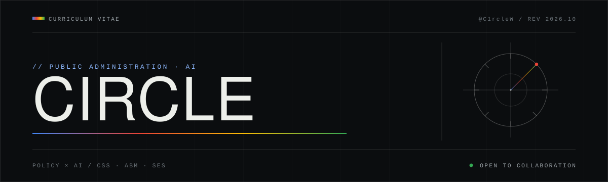
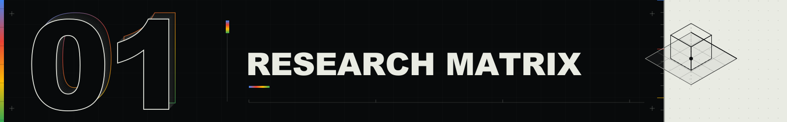
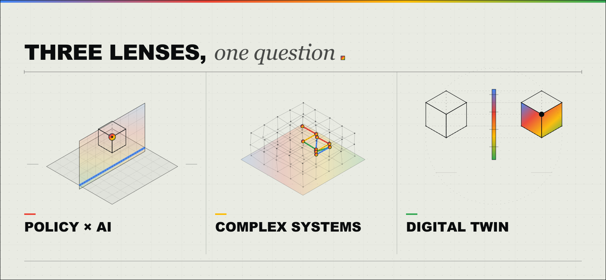
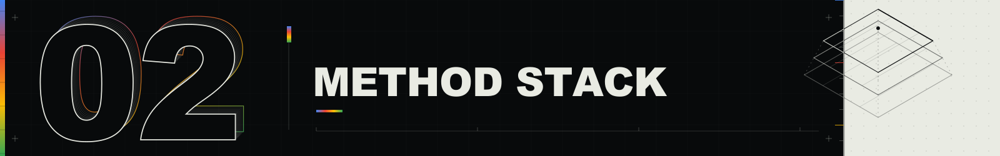
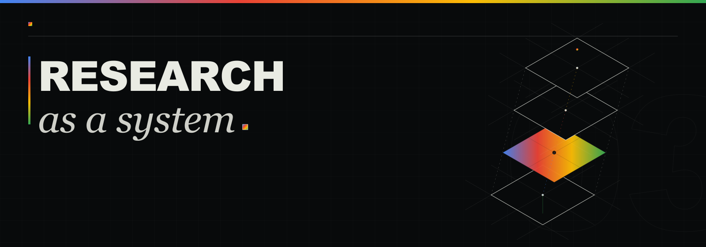
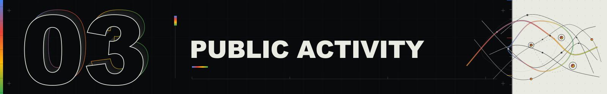
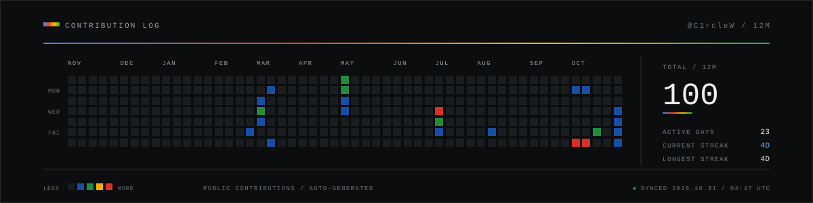
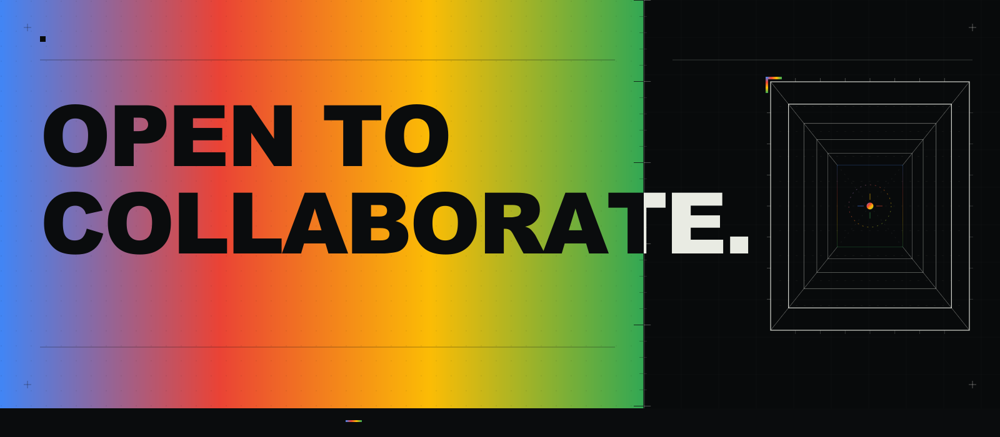

  

<table>
  <tr>
    <td width="18%" valign="top"><samp>POSITION</samp></td>
    <td width="82%" valign="top"><strong>PA Student</strong>&nbsp;&nbsp;·&nbsp;&nbsp;Public Administration</td>
  </tr>
  <tr>
    <td valign="top"><samp>FIELD</samp></td>
    <td valign="top"><strong>Policy × AI</strong>&nbsp;&nbsp;·&nbsp;&nbsp;CSS · ABM · SES</td>
  </tr>
  <tr>
    <td valign="top"><samp>SIGNAL</samp></td>
    <td valign="top"><strong>Open to Collaboration</strong></td>
  </tr>
</table>

> I use simple models and clear visuals to examine policy questions.

### RESEARCH

  

Three lenses, one question: **how do rules, incentives, and networks shape behavior?**

  

<table>
  <tr>
    <td width="24%" valign="top"><strong>Policy × AI</strong></td>
    <td width="76%" valign="top">Public value in algorithmic decisions.</td>
  </tr>
  <tr>
    <td valign="top"><strong>Complex Systems</strong></td>
    <td valign="top">Agent-based models of emergence and institutions.</td>
  </tr>
  <tr>
    <td valign="top"><strong>Digital Twin Governance</strong></td>
    <td valign="top">Digital twins as governance interfaces.</td>
  </tr>
</table>

### METHOD STACK

  

  

<table>
  <tr>
    <td width="22%" valign="top"><samp>MODEL</samp></td>
    <td width="78%" valign="top"><strong>ABM · CSS · SES</strong></td>
  </tr>
  <tr>
    <td valign="top"><samp>BUILD</samp></td>
    <td valign="top"><strong>Python · TypeScript · HTML/CSS</strong></td>
  </tr>
  <tr>
    <td valign="top"><samp>THINK</samp></td>
    <td valign="top"><strong>Policy · Networks</strong></td>
  </tr>
  <tr>
    <td valign="top"><samp>WRITE</samp></td>
    <td valign="top"><strong>Reproducible research</strong></td>
  </tr>
</table>

<samp>WORKING STYLE</samp> — research first · reproducible when possible · clear about limits.

### PUBLIC ACTIVITY

  

Public GitHub contributions, last 12 months — updated daily.

  

### CONTACT

  

Open to conversations on policy, AI governance, and complex systems.

  <a href="mailto:wzy999999097@gmail.com"><samp>EMAIL ↗</samp></a>&nbsp;&nbsp;/&nbsp;&nbsp;
  <a href="https://github.com/C1rcleW"><samp>GITHUB ↗</samp></a>

   
  <samp>README / CIRCLE (C1rcleW) · REV 2026.10 · © 2026 CIRCLE</samp>

